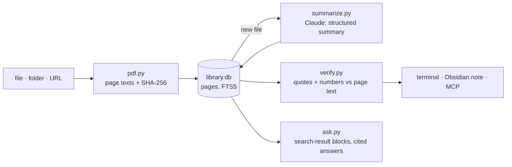

# pagecite

**Summaries of research PDFs you can actually trust: every claim cites its page, and every quote
and number is checked against the PDF before you see it.**

Point it at a paper, an analyst report or a pitch deck (a file, a folder or a URL). Claude writes
the TL;DR, key arguments, data points, quotes worth keeping and open questions. Then pagecite
checks each one against the PDF's own text, with no model involved: is the quote really on the
cited page? Do the numbers appear there? Anything that fails is kept but marked **⚠ not
verified**, with the reason, so a wrong page or a mangled figure never passes as fact.

[](https://github.com/owen-alderson/pagecite/actions/workflows/ci.yml)
[](https://pypi.org/project/pagecite/)


<sub>`pagecite demo`: a fictional report and a sample summary bundled with pagecite (no API call),
with two claims deliberately wrong. The checks are the real ones.</sub>

## Why

AI summaries read well and are hard to audit. The usual failure isn't a summary that's obviously
wrong. It's a plausible sentence with a number that drifted ("27%" where the report says 22%), or a
quote that's real but from a different section than the claim it supports. You only catch those
by rereading the document, which is what the summary was supposed to save you.

pagecite splits the work:

| | Who | What |
|---|---|---|
| **Writes** | Claude (`claude-opus-5-5`) | Reads the PDF page by page and returns a structured summary. Every argument and data point carries its page numbers and a verbatim quote. |
| **Checks** | Plain code, [`verify.py`](pagecite/verify.py) | Finds each quote on its cited page and each number in the data points on that page. No model, so no second opinion that can also be wrong. |
| **Decides** | You | Verified claims are marked ✓. Flagged ones stay in, marked ⚠ with the reason ("quote is on p. 7, not the cited p. 5", "27 not on the cited page"). |

## What it does

- **Any PDF source:** a file, every PDF in a folder, or an `http(s)` URL.
- **Checked summary:** TL;DR, key arguments, data points, quotes worth keeping, open questions and
  tags, each with page numbers. Quotes and figures are verified; open questions and the TL;DR show
  their pages but have nothing quotable to check.
- **Obsidian notes:** `-o ~/Vault/Papers` writes each summary as a Markdown note with YAML
  frontmatter (source, pages, model, verified/flagged counts, tags) and the flags inline.
- **A library:** every PDF you read is stored with its page text, keyed by its SHA-256. Summarising
  the same file again (even under another name) costs nothing. `pagecite search` runs full-text
  search over every page you've read.
- **Ask with citations:** `pagecite ask "what drives the cost gap?" --doc 3` answers from the
  document with [citations](https://platform.claude.com/docs/en/build-with-claude/search-results)
  returned by the API itself, so every sentence points to a page. For one document all its pages
  are sent with a cache breakpoint, so follow-up questions read them from the prompt cache. Without
  `--doc`, the best-matching pages across your library are sent.
- **MCP server:** Claude Desktop, Claude Code or any MCP client can summarise PDFs, search your
  library, read pages and ask cited questions.

## Quickstart

```bash
pipx install pagecite
pagecite demo                  # a checked summary on a fictional report, no key needed
```

With your own documents:

```bash
mkdir -p ~/.pagecite && echo 'ANTHROPIC_API_KEY=sk-ant-...' >> ~/.pagecite/.env   # or `ant auth login`

pagecite summarize paper.pdf
pagecite summarize ~/Downloads/reports -o ~/Obsidian/Papers   # a whole folder, as notes
pagecite summarize https://arxiv.org/pdf/1706.03762
pagecite ask "what did they measure, and on what data?" --doc 1
```

| Command | |
|---|---|
| `pagecite summarize SOURCE… [-o DIR] [--refresh]` | Summarise files, folders or URLs (alias `sum`) |
| `pagecite ask QUESTION [--doc ID]` | Answer from one document or the whole library, with page citations |
| `pagecite list` | The PDFs in your library (alias `ls`) |
| `pagecite show ID [--markdown]` | Print a stored summary, or its Obsidian note |
| `pagecite search QUERY [--doc ID]` | Full-text search over every page |
| `pagecite mcp` | Run the MCP server over stdio |
| `pagecite demo` | The demo above |

## What counts as verified

[`verify.py`](pagecite/verify.py) is short and has no dependencies, so the rules are easy to check:

- **Quotes** must appear on the page(s) they cite. Matching ignores case, punctuation, spacing,
  ligatures (`fi`) and words split across lines (`con-`/`straint`), but keeps decimal points, so
  "4.2" never matches "42". An ellipsis splits a quote into parts that must appear in order.
  Quotes under four words are flagged as too short to prove anything.
- **Numbers** in a data point's value must all appear on the cited page: "USD 115 per kWh, down
  14%" needs both 115 and 14 there. Thousands separators are normalised (`3,200` = `3200` =
  `3 200`).
- **Pages** must exist in the document.
- When a quote is on a different page, the flag says where it really is. pagecite never moves
  the citation for you.

What it can't check: whether a sentence in Claude's own words fairly represents its quote.
That's why each claim shows the quote right under it.

Scanned PDFs without a text layer are refused (OCR them first). Documents too long for one pass
are refused rather than silently truncated.

### What leaves your machine

| | Sent to Anthropic |
|---|---|
| `summarize` | the extracted text of the whole PDF |
| `ask --doc ID` | every page of that document |
| `ask` | only the best-matching pages from your library |
| `list`, `show`, `search`, `demo` | nothing |

Your library is one SQLite file, `~/.pagecite/library.db`.

## MCP

Add to Claude Desktop's `claude_desktop_config.json` (or `claude mcp add pagecite -- pagecite mcp`
in Claude Code):

```json
{
  "mcpServers": {
    "pagecite": { "command": "pagecite", "args": ["mcp"] }
  }
}
```

Install with `pipx install 'pagecite[mcp]'`. Tools: `summarize_pdf` (returns each claim with its
check result), `ask_library`, `search`, `read` (page text) and `documents`. `search`, `read` and
`documents` need no API key.

## Configuration

In `~/.pagecite/.env` or the environment (see [`.env.example`](.env.example)):

| Variable | Default | |
|---|---|---|
| `ANTHROPIC_API_KEY` | | Or log in once with `ant auth login` |
| `PAGECITE_NOTES_DIR` | | Always write notes here (e.g. a folder in your vault) |
| `PAGECITE_MODEL` | `claude-opus-5-5` | |
| `PAGECITE_DB` | `~/.pagecite/library.db` | |

## How it works



Verification runs every time a summary is shown, against the stored page text, so a stored
summary never carries a stale result.

## Development

```bash
git clone https://github.com/owen-alderson/pagecite && cd pagecite
python -m venv .venv && . .venv/bin/activate
pip install -e '.[dev]'
pytest            # no network: Claude and HTTP are faked, test PDFs are generated
```

Releases: push a `vX.Y.Z` tag and GitHub Actions publishes to PyPI. Re-record the demo with
`vhs docs/demo.tape`.

The original Streamlit app (pdf-research-summarizer) is kept at tag
[`v1-streamlit`](https://github.com/owen-alderson/pagecite/tree/v1-streamlit).

## License

MIT
